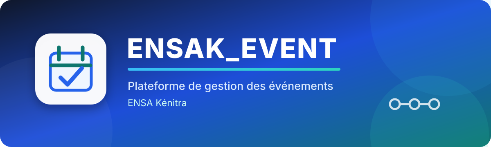

  

   

  

    
    
    
  

  

    
    
    
  

  <h3>Nous arrivons bientôt — la meilleure communauté de développeurs !</h3>

  

    Une plateforme web pour gérer, contrôler et présenter les événements de
    <strong>l'École Nationale des Sciences Appliquées de Kénitra</strong>.
  

  

    <a href="#-présentation">Présentation</a> •
    <a href="#-objectifs">Objectifs</a> •
    <a href="#-profils-utilisateurs">Profils</a> •
    <a href="#-technologies-et-outils">Technologies</a> •
    <a href="#-équipe-du-projet">Équipe</a>
  

---

##  Présentation

**ENSAK_EVENT** est une application web conçue pour centraliser la gestion des événements organisés au sein de l'ENSA Kénitra.

La plateforme propose deux espaces principaux :

<table>
  <tr>
    <td align="center" width="50%">
      <h3> Administrateur</h3>
      
Supervision, validation et suivi global de la plateforme.

    </td>
    <td align="center" width="50%">
      <h3> Organisateur</h3>
      
Création, suivi et gestion des événements et des participants.

    </td>
  </tr>
</table>

---

##  Objectifs

La plateforme permet notamment :

- de gérer les demandes d'organisation d'événements ;
- de valider ou de refuser les demandes des organisateurs ;
- de suivre les demandes de modification ;
- de consulter les événements programmés ;
- de gérer les participants ;
- d'afficher les événements dans un calendrier interactif ;
- de fournir des statistiques aux administrateurs et aux organisateurs.

---

##  Profils utilisateurs

<strong> 1. Profil Administrateur</strong>

 

L'administrateur dispose d'un espace lui permettant de superviser l'ensemble de la plateforme.

###  Tableau de bord

Le tableau de bord présente des statistiques sur l'activité de l'application :

- les demandes de création d'événements ;
- les demandes de modification d'événements ;
- les événements et demandes approuvés ;
- les demandes d'inscription en tant qu'organisateur ;
- un graphique représentant le nombre d'événements par mois ;
- la répartition des demandes selon leur statut : **approuvée**, **en cours de traitement** ou **à modifier** ;
- des statistiques sur les profils des participants inscrits aux événements approuvés.

###  Demandes d'inscription des organisateurs

L'administrateur peut consulter et évaluer les demandes envoyées par les responsables de clubs, les entreprises et les professeurs souhaitant obtenir un compte organisateur sur la plateforme.

###  Gestion des organisateurs

Une liste permet de consulter les utilisateurs ayant accès à la plateforme en tant qu'organisateurs.

###  Demandes d'organisation d'événements

L'administrateur peut examiner les demandes de création d'événements envoyées par les organisateurs préalablement vérifiés par l'administration.

###  Demandes de modification d'événements

Lorsqu'un organisateur souhaite modifier une information importante liée à la promotion d'un événement, telle que sa date ou son lieu, une demande est envoyée à l'administration pour validation.

###  Événements programmés

L'administrateur peut consulter la liste des événements organisés avec les informations suivantes :

- le lieu ;
- la date ;
- le titre ;
- les détails de l'événement.

Un bouton permet d'afficher davantage d'informations sur chaque demande.

###  Calendrier

Le calendrier affiche tous les événements ainsi que leurs plages horaires. Il propose plusieurs vues :

- mensuelle ;
- hebdomadaire ;
- journalière.

###  Déconnexion

L'administrateur peut se déconnecter de son espace. Il est ensuite redirigé vers la page de connexion.

 

<strong> 2. Profil Organisateur</strong>

 

L'organisateur dispose d'un espace dédié à la création, au suivi et à la gestion de ses événements.

###  Tableau de bord

Le tableau de bord affiche des statistiques sur tous les événements proposés par l'organisateur, notamment la répartition des participants selon leur profil :

- Cycle préparatoire (**CP**) ;
- Cycle ingénieur (**CI**) ;
- Master ;
- Professeur ;
- Autres profils.

###  Création d'un événement

L'organisateur peut soumettre un nouvel événement depuis son espace. Le formulaire contient notamment :

| Informations générales | Planification |
| --- | --- |
| Titre | Date de début |
| Type d'événement | Date de fin |
| Détails et description | Date limite d'inscription |
| Lieu | — |

Une fois remplie, la demande est envoyée à l'administrateur, qui peut l'évaluer, l'accepter ou la refuser.

###  État des demandes

L'organisateur peut consulter l'état de ses demandes d'organisation d'événements.

###  Participants

Pour chaque événement, l'organisateur peut consulter la liste des participants inscrits. Cette liste contient :

- l'adresse e-mail ;
- le nom ;
- le prénom ;
- le profil du participant : étudiant en cycle préparatoire, étudiant en cycle ingénieur, étudiant en master ou professeur.

###  Calendrier

Le calendrier affiche tous les événements ainsi que leurs plages horaires. Les événements peuvent être consultés par mois, par semaine ou par jour.

###  Création d'un compte organisateur

Un responsable de club, par exemple, qui ne possède pas encore de compte organisateur peut sélectionner l'option **Create Account**. Une demande est alors envoyée à l'administrateur.

L'administrateur évalue cette demande et vérifie si l'utilisateur satisfait aux critères obligatoires pour devenir organisateur sur la plateforme ENSAK_EVENT.

###  Déconnexion

L'organisateur peut se déconnecter de son espace. Il est ensuite redirigé vers la page de connexion afin de pouvoir se reconnecter ultérieurement.

---

##  Technologies et outils

<table>
  <thead>
    <tr>
      <th align="center">Technologie / outil</th>
      <th>Utilisation</th>
    </tr>
  </thead>
  <tbody>
    <tr><td align="center"><strong>GitHub</strong></td><td>Coordination de l'équipe, gestion des versions et structuration du travail.</td></tr>
    <tr><td align="center"><strong>Flowbite</strong></td><td>Utilisation de modèles de composants existants : barres de navigation, boutons et cartes.</td></tr>
    <tr><td align="center"><strong>HTML, CSS, Bootstrap et JavaScript</strong></td><td>Développement de l'interface utilisateur.</td></tr>
    <tr><td align="center"><strong>PHP</strong></td><td>Développement de la partie back-end.</td></tr>
    <tr><td align="center"><strong>DrawSQL</strong></td><td>Conception des schémas conceptuel et relationnel, des tables, attributs, clés et contraintes.</td></tr>
    <tr><td align="center"><strong>phpMyAdmin</strong></td><td>Interface de gestion, de contrôle et d'adaptation de la base de données MySQL.</td></tr>
    <tr><td align="center"><strong>000webhost</strong></td><td>Hébergement de l'application web et gestion de la base de données en ligne.</td></tr>
  </tbody>
</table>

---

##  Équipe du projet

Le projet est réalisé par une équipe en génie informatique, cohérente, compétente et techniquement engagée dans la conception et la résolution des différentes problématiques du projet.

<table>
  <tr>
    <td align="center" width="25%"><strong>Abdelhamid Hachimi Alloui</strong></td>
    <td align="center" width="25%"><strong>Omar Ignammas</strong></td>
    <td align="center" width="25%"><strong>Yahya Kaddouri</strong></td>
    <td align="center" width="25%"><strong>Ilyas Lirmaqui</strong></td>
  </tr>
</table>

---

  <h3>ENSAK_EVENT</h3>
  
<strong>Gérer • Organiser • Participer</strong>

  
Réalisé avec passion par l'équipe ENSAK_EVENT.

